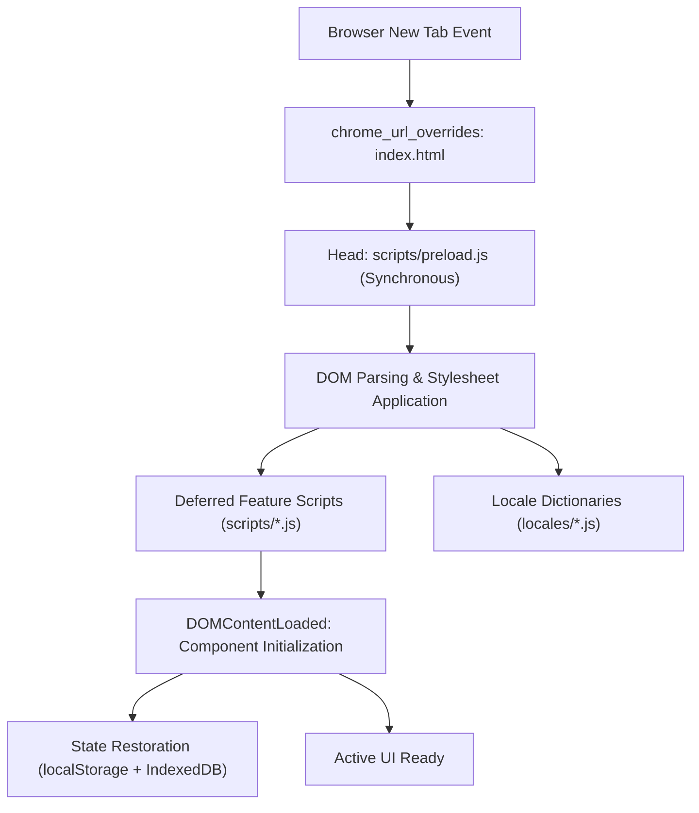
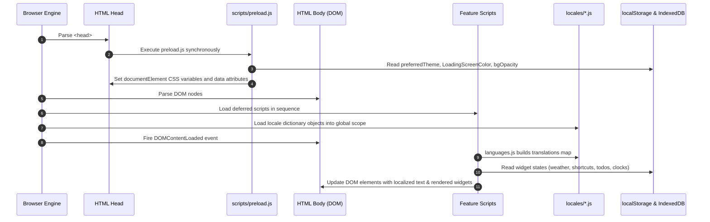
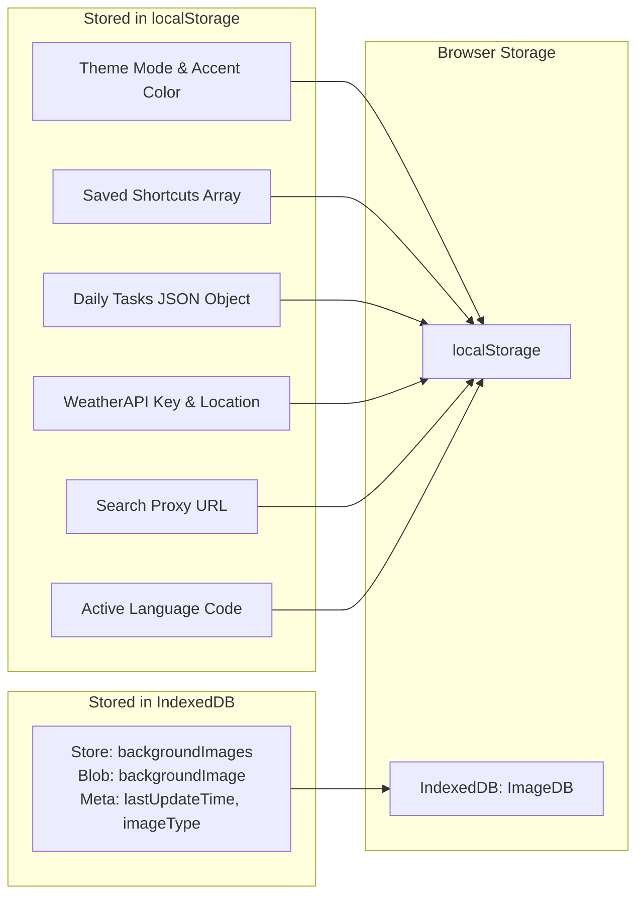
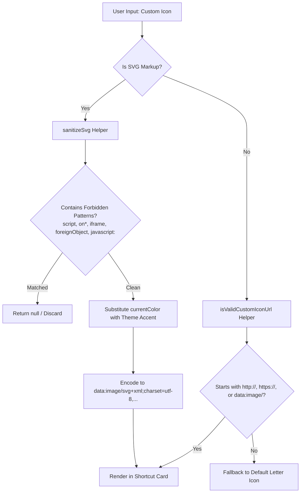

# MYNT: Material You New Tab — Architecture Specification

## 1. System Overview

**MYNT (Material You New Tab)** is a privacy-centric, highly customizable browser extension built around Google's Material You design philosophy. It operates as a local New Tab override (`chrome_url_overrides.newtab`) conforming to the **Chrome Extensions Manifest V3** standard.

The architecture emphasizes:
- **Zero build dependencies**: Pure client-side HTML5, CSS3, and vanilla ES6+ JavaScript. No transpilers, bundlers, or UI frameworks.
- **Local-first persistence**: All user data, settings, tasks, bookmarks state, and uploaded wallpapers are stored locally within the browser via `localStorage` and `IndexedDB`.
- **Zero telemetry**: No trackers, analytics, or background reporting.
- **Fast rendering**: A synchronous preload phase prevents theme and transparency flashing before initial layout.

> [!NOTE]
> **Repository Convention: Dual Role of `docs/`**
> In this repository, the `docs/` directory serves two distinct purposes:
> 1. **Extension runtime pages**: User-facing HTML documents included in the extension bundle (`docs/whats-new.html`, `docs/feedback.html`, `docs/Get_WeatherAPI_Key.html`). `scripts/background.js` opens `/docs/whats-new.html` upon extension update.
> 2. **Engineering documentation**: Developer-facing architecture and workflow specifications (`docs/architecture.md`, `docs/development.md`).

---

## 2. Directory Layout and File Responsibilities

| Path | Category | Responsibility |
|---|---|---|
| `manifest.json` | Configuration | Manifest V3 specification: permissions, background worker, URL overrides, icons. |
| `index.html` | Entry Point | Core DOM markup for new tab dashboard, widget containers, and script imports. |
| `style.css` | Styling | CSS custom properties for theming, typography, layouts, and animations. |
| `privacy-policy.html` | Extension Page | Local privacy policy document explaining zero-data-collection policy. |
| `scripts/preload.js` | Core Runtime | Runs synchronously in `<head>` to set CSS custom properties before first paint. |
| `scripts/languages.js` | Internationalization | Applies translations to DOM elements, maps numeral systems, handles RTL layouts. |
| `scripts/theme.js` | Appearance | Manages light/dark/system themes and custom accent color selection. |
| `scripts/clock.js` | Widget | Analog clock calculations, digital clock formatting, and dynamic greetings. |
| `scripts/weather.js` | Widget | WeatherAPI integration, GPS geolocation, autocomplete, and temperature toggles. |
| `scripts/search.js` | Widget | Multi-engine search routing and search bar interactions. |
| `scripts/search-suggestions.js` | Widget | Suggestion fetching via proxy with keyboard and mouse navigation. |
| `scripts/voice-search.js` | Widget | Web Speech API integration for speech-to-text queries. |
| `scripts/shortcuts.js` | Widget | Shortcut rendering, adaptive icons, custom SVG sanitization, drag-and-drop. |
| `scripts/ai-tools.js` | Widget | Quick links for AI services and customizable ordering modal. |
| `scripts/bookmarks.js` | Feature | Chrome/Firefox Bookmarks API integration, search filter, and sidebar views. |
| `scripts/todo-list.js` | Widget | Daily task management, item pinning, and auto-cleanup. |
| `scripts/quotes.js` | Widget | Fetches motivational quotes from remote API with fallback support. |
| `scripts/wallpaper.js` | Feature | Custom wallpaper upload to IndexedDB, random Lorem Picsum wallpapers. |
| `scripts/widgets-transparency.js` | Feature | Interactive transparency slider adjusting `--transparency` CSS variable. |
| `scripts/custom-text.js` | Feature | User-editable text banner beneath the clock. |
| `scripts/google-apps.js` | Feature | 9-dot launcher menu for Google Workspace services. |
| `scripts/backup-restore.js` | Feature | Exports and restores localStorage and IndexedDB data as a JSON file. |
| `scripts/alert-modal.js` | UI Utility | In-tab custom modal dialogs replacing standard browser alert/confirm prompts. |
| `scripts/menu-shortcut-page.js` | UI Navigation | Slide-out settings drawer animation and page navigation. |
| `scripts/browser-utils.js` | Utility | Browser vendor and platform detection flags (Firefox, Chrome, Edge, Brave, Mac). |
| `scripts/save-load-states.js` | Utility | Helper functions for persisting checkbox and display states. |
| `scripts/background.js` | Service Worker | MV3 background service worker handling `onInstalled` update tabs and uninstall URL. |
| `locales/*.js` | Internationalization | 32 standalone locale dictionary files defining UI string maps. |
| `favicon/` | Assets | Extension icons (16px, 48px, 128px). |
| `fonts/` | Assets | Local TTF font `Poppins-Regular.ttf`. |
| `images/` | Assets | Loading screen placeholder graphic. |
| `svgs/` | Assets | Standalone vector assets used across widgets. |
| `tests/` | Quality Assurance | Automated test suite executed via Node.js native test runner (`node --test`). |

---

## 3. Execution Lifecycle and Data Flow

### 3.1 Script Loading and Initialization Sequence

### 3.2 Theming and FOUC Prevention
To eliminate the Flash of Unstyled Content (FOUC):
1. `preload.js` runs synchronously before the `<body>` element is rendered.
2. It immediately retrieves:
   - `LoadingScreenColor` (default: `#bbd6fd`)
   - `bgOpacity` (widget transparency)
   - `preferredTheme` (`light`, `dark`, or `system`)
3. Attributes `data-preferred-theme` and `data-system-dark` are attached directly to `<html>`, enabling early CSS media-query matching before external resources finish loading.
4. When `theme.js` executes, it synchronizes the custom color plate radio buttons and the segmented theme toggle.

---

## 4. Subsystems and Architectural Components

### 4.1 Storage Architecture

Data persistence is split across two browser storage mechanisms:

#### Key `localStorage` Entries:
- `selectedTheme`: Current theme name or color token.
- `customThemeColor`: Hex color code chosen via the color picker.
- `preferredTheme`: Theme mode (`light`, `dark`, `system`).
- `bgOpacity`: Percentage opacity (20–100) mapped to `--transparency`.
- `selectedLanguage`: ISO language code (e.g., `en`, `es`, `zh`, `ar_SA`).
- `shortcuts`: Array of shortcut objects `{ name, url, iconUrl }`.
- `todoList`: JSON map of tasks keyed by unique ID `t<timestamp>`.
- `weatherApiKey`: User-supplied WeatherAPI key.
- `weatherLocation`: Saved location name or query.
- `useGPS`: Boolean flag for browser geolocation.
- `proxy`: Custom search suggestion proxy URL.

### 4.2 Internationalization (i18n) Engine
- **32 Independent Locale Files**: Each file in `locales/` defines a global dictionary (`const <langCode> = { ... }`).
- **Translation Aggregator**: `scripts/languages.js` builds the master `translations` object mapping each language code to its dictionary.
- **RTL Support**: Urdu (`ur`), Persian (`fa`), and Arabic (`ar_SA`) trigger Right-to-Left layout modifications and Left-to-Right Marks (`LRM = "\u200E"`).
- **Numeral Localization**: Maps Western Arabic numerals (0–9) to native glyphs for Bengali (`bn`), Tamil (`ta`), Marathi (`mr`), Nepali (`ne`), Persian (`fa`), and Arabic (`ar_SA`).
- **Decimal Localization**: Automatically substitutes decimal periods with commas for 19 European and Asian languages.

### 4.3 Shortcuts and Security Model
The shortcut manager (`scripts/shortcuts.js`) supports user-entered URLs and custom icons (both image URLs and inline SVG markup). Because user-supplied markup could present Cross-Site Scripting (XSS) risks, the system implements multi-layer defense:

---

## 5. External Network Integrations

All external integrations are strictly optional and configured with fallbacks:

1. **Weather Data**: Requests sent to `https://api.weatherapi.com/v1/forecast.json`. Requires user's personal API key stored in `localStorage`.
2. **Search Suggestions Proxy**: Routes autocomplete queries through `https://mynt-proxy.rhythmcorehq.com/proxy?url=` to bypass CORS restrictions on search provider endpoints (Google, DuckDuckGo, Brave, Wikipedia). Users can configure a custom proxy URL.
3. **Multilingual Quotes**: Fetches daily quotes from `https://prem-k-r.github.io/multilingual-quotes-api/minified/`. If offline or unavailable, falls back to hardcoded local quotes.
4. **Random Wallpaper**: Sourced from `https://picsum.photos` when the user enables the random wallpaper feature.
