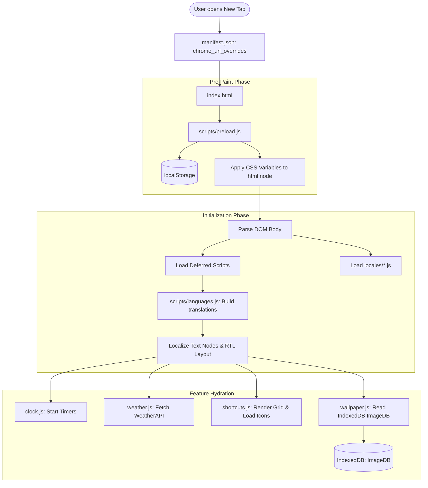

# Project Memory — MYNT: Material You New Tab

**Last Updated:** 2026-11-07  
**Repository Branch:** `main` (`origin/main`)  
**Git Remote:** `https://github.com/ANShKhare-ux/MYNT-2.0.git`  
**License:** GNU General Public License v3.0 (GPL-3.0)  

---

## 1. Project Identity and Purpose

**MYNT (Material You New Tab)** is a privacy-first, highly customizable browser extension that replaces the browser's default New Tab page (`chrome_url_overrides.newtab`) with a clean dashboard inspired by Google's **Material You** design language.

Core goals:
- **Zero Data Collection**: No user tracking, telemetry, or remote analytics; all settings and data reside locally.
- **Material You Design**: Dynamic color palette adaptation, dark/light/system theme toggling, widget transparency controls, and adaptive icons.
- **Productivity & Utilities**: Integrated search with multi-engine switching and voice typing, live weather, shortcuts with drag-and-drop, AI tools launcher, daily to-do list, bookmarks sidebar, Google apps launcher, and motivational quotes.
- **Global Accessibility**: Full internationalization supporting 32 languages, including RTL layouts (Arabic, Persian, Urdu) and native numeral localization.

---

## 2. Current Implementation Status

### Implemented Features (Verified)
- **Manifest V3 Core**: Manifest defined with MV3 compliance, split incognito mode, and service worker background lifecycle.
- **Theming & Appearance**:
  - Segmented control for Light / Dark / System themes (`scripts/theme.js`).
  - Preload script (`scripts/preload.js`) running in `<head>` to prevent Flash of Unstyled Content (FOUC).
  - Custom color picker setting CSS custom property accent colors.
  - Interactive transparency slider (`scripts/widgets-transparency.js`) controlling `--transparency` on widgets.
  - **Glassmorphism System**: Native, hardware-accelerated frosted glass layer (`backdrop-filter: blur(...) saturate(...)`) with specular edge reflections, inner glows, and floating elevation across all widgets, sidebars, shortcuts, settings drawer cards (`.sectionInner`, `.sectionOuter`, `.innerSurface`), shortcut edit page sticky header (`.topBar`), and **all interactive buttons** in wallpaper mode:
    - **Appearance & Wallpaper Buttons**: `.uploadButton`, `.randomButton`, `.videoButton`, `.switchMediaButton`, `.clearButton`, `.themeSegment`, `.themeIndicator`, `#themeButton`, `.colorsContainer`, `.colorsContainer input[type="radio"]` (frosted glass jewel swatches with specular bevels and checked halos), `.colorPickerLabel`, and `.opacitySlider`.
    - **Search & Navigation Buttons**: `#enterBtn`, `#todoAdd`, `.dot-icon`, `.bookmark-button`, `.savebtn`, `.backupRestoreBtn`, `.resetbtn`, `#dontShowTips`, and floating action button `#menuButton`.
    - **Shortcut & Modal Action Buttons**: `#backButton`, `#newShortcutButton`, `#resetButton`, `.uploadCustomIconButton`, `.shortcutDelete button`, `.prompt-modal-button`, `.ai-reset-button`, `.ai-save-button`, and bookmark sorting/view buttons.
    - **Shortcuts, Color Palette & Dock Glassmorphism**: Shortcut icon badges (`.shortcutsContainer .shortcuts .shortcutLogoContainer`) and color palette cards (`.colorsContainer`, `#themeButton`, `.colorPlate`, `.colorPickerLabel`) render as translucent frosted glass surfaces with specular borders and floating elevation, replacing opaque solid white backgrounds across color cards. In both light and dark wallpaper modes, shortcut badges and `#menuButton` dynamically adhere to the active color theme (`var(--darkColor-blue)` and `var(--accentLightTint-blue)`), keeping icon glyphs crisp white (`#ffffff`) and eliminating hardcoded monochrome greys, alongside frosted glass dock backdrop (`.shortcutsContainer::before`) and concentric frosted `#menuButton`.
    - Fixes top drawer header alignment, eliminates stark solid white headers and buttons in wallpaper/dark modes, ensures high-contrast typography, adapts smoothly to light/dark themes, and provides accessibility fallback for `prefers-reduced-transparency`.
  - **Fluid Motion & Physics-Based Micro-Interactions System**:
    - Grounded in Apple Fluid Design (WWDC) and Material 3 Emphasized Motion physics, replacing static transitions with tactile curves:
      - `--fluid-spring`: `cubic-bezier(0.34, 1.35, 0.64, 1)` for snappy spring overshoot.
      - `--fluid-spring-bouncy`: `cubic-bezier(0.34, 1.56, 0.64, 1)` for playful bouncing states on color swatches and icon badges.
      - `--fluid-ease-out`: `cubic-bezier(0.16, 1, 0.3, 1)` for ultra-smooth sheet, drawer, and modal deceleration.
      - `--fluid-ease-in-out`: `cubic-bezier(0.65, 0, 0.35, 1)` for symmetrical state transitions.
      - `--fluid-press`: `cubic-bezier(0.4, 0, 0.2, 1)` for instant (70–80ms) physical depression feedback upon pointer-down.
    - **Staggered Dock Entrance**: `@keyframes shortcutStaggerIn` floats shortcuts into view sequentially on tab open.
    - **Tactile Active Press Feedback**: Universal `:active` feedback across all action buttons, swatches, modals, and navigation controls eliminating perceived input latency.
    - **Compositor-Only Drawer Transitions**: Replaces expensive `transition: all 0.5s/0.6s` with hardware-accelerated `transform 0.42s var(--fluid-ease-out)` and `opacity 0.35s var(--fluid-ease-out)` across `.menuBar`, `.menuCont`, and `.optCont`.
    - **Spring Chevrons & Collapsible Cards**: Chevrons rotate with snappy spring overshoot (`transform 0.35s var(--fluid-spring)`), and cards unroll smoothly with `--fluid-ease-out`.
    - **Dialog & Modal Spring-In**: Dialogs (`#prompt-modal-container`, `.ai-settings-modal`, `#editBookmarkModal`) spring into view via `@keyframes modalSpringIn` accompanied by smooth backdrop blur fade (`@keyframes modalOverlayFadeIn`).
    - **Color Swatch Bounce**: Swatches depress on pointer-down and bounce into selection via `@keyframes swatchSelectBounce`.
    - **Menu Close Button Polish**: Fixed dangling properties and unmatched closing brace at lines 4885–4888, unifying `#menuCloseButton:hover` with smooth width expansion (`0.4s var(--fluid-ease-out)`), spring hover (`scale(1.02)`), tactile press (`scale(0.94)`), and restoring `margin-top: var(--gap)`.
    - **Reduced Motion Fallback**: Full conformance with `@media (prefers-reduced-motion: reduce)` zeroing animation durations for vestibular accessibility.
- **Clock Subsystem (`scripts/clock.js`)**:
  - Dual modes: Analog (smooth rotating hands) and Digital (12h/24h formats).
  - Contextual time-of-day greetings (Morning / Afternoon / Evening).
  - Customizable visibility toggles with responsive auto-adaptation for mobile viewports.
- **Weather Subsystem (`scripts/weather.js`)**:
  - Real-time weather via WeatherAPI integration.
  - GPS geolocation (`navigator.geolocation`) and manual location lookup with autocomplete.
  - Temperature display in Celsius (°C) and Fahrenheit (°F), humidity, condition text, and min/max metrics.
- **Search & Suggestions (`scripts/search.js`, `scripts/search-suggestions.js`, `scripts/voice-search.js`)**:
  - 9 search engines supported: Google, DuckDuckGo, Bing, Brave, YouTube, Google Images, Reddit, Wikipedia, Quora.
  - **Google AI Search Mode**: Interactive Material pill button (`[Sparkle-Lens Icon] AI Mode`) in `.searchControls`. Directs queries to Google AI Search via official parameter `udm=50` (`https://www.google.com/search?q=${query}&udm=50` or `https://www.google.com/search?udm=50`). Automatically displays for Google (`engine1`) and Default browser engine (`engine0`), while dynamically hiding for non-Google engines.
  - Dynamic autocomplete suggestions routed through a dedicated proxy (`https://mynt-proxy.rhythmcorehq.com/proxy?url=`) or user-configured proxy.
  - Speech-to-text voice search using the Web Speech API on supported Chromium browsers.
- **Shortcuts & AI Launchers (`scripts/shortcuts.js`, `scripts/ai-tools.js`)**:
  - Up to 50 customizable shortcuts with adaptive Material You icons or user-supplied SVG/image URLs.
  - Strict SVG sanitization (`sanitizeSvg`) and URL validation preventing XSS injection.
  - Drag-and-drop shortcut reordering and numerical keyboard hotkeys (1–9).
  - AI launcher drawer with toggles and reordering for 10 AI platforms (ChatGPT, Gemini, Copilot, Claude, DeepSeek, Perplexity, Grok, Meta AI, Qwen, Firefly).
- **Bookmarks & Tasks (`scripts/bookmarks.js`, `scripts/todo-list.js`)**:
  - Bookmarks sidebar supporting grid and list views, search filtering, and sorting (alphabetical / date added).
  - Daily to-do list with pin feature and automatic new-day cleanup.
- **Wallpaper & Video Background Engine (`scripts/wallpaper.js`)**:
  - Local image and video upload stored as Blobs in IndexedDB (`ImageDB`).
  - **Dual-Media Storage & Instant Switching**: Separately stores `"uploadedImage"` and `"uploadedVideo"` in IndexedDB while maintaining `"backgroundImage"` as the active media. Allows users to switch seamlessly between their uploaded photo and uploaded video anytime via the dedicated `#switchMediaTrigger` button in the Appearance card, with contextual prompts to upload if one is missing, and dynamic tooltips indicating the switch target.
  - **Hardware-Accelerated Video Backgrounds**: Supports MP4, WebM, and OGG video wallpapers. Fixed-position compositor layer (`transform: translateZ(0); will-change: transform; backface-visibility: hidden; pointer-events: none;`) leveraging Intel HD Graphics Quick Sync hardware decoding with near-zero CPU usage.
  - **Muted Autoplay Pipeline with Gesture Recovery**: Strict conformance with Chromium Autoplay Policy (`muted`, `defaultMuted`, `playsinline`, `autoplay`, `video.load()`), dual event readiness hooks (`canplay`, `loadeddata`), loop continuity recovery (`onended`), and transparent first-interaction gesture fallback ensuring instant, unbreakable autoplay.
  - **Strict Resource & Battery Optimizations**:
    - **Tab Visibility API**: Halts video decoding (`video.pause()`) when tab is hidden or minimized, dropping CPU/GPU decoding to 0.0%, and seamlessly resumes on tab focus/return.
    - **Reduced Motion Support**: Automatically pauses video when `prefers-reduced-motion: reduce` is enabled.
    - **Zero-Friction Autoplay**: Autoplays immediately on upload, tab open, or switch without manual play/stop buttons cluttering the UI.
    - **Memory Leak Protection**: Instant `URL.revokeObjectURL(previousUrl)` cleanup and decoder flush (`video.removeAttribute('src')`, `video.load()`) prevents RAM leaks on 8GB systems.
    - **File Size Safeguards**: Warns user if video upload exceeds 100MB to protect memory bandwidth.
    - **Low-Overhead Dynamic Wallpaper & Video Theme Color Engine**: Automatically samples playing video frames or static image wallpapers and smoothly adapts the Material You interface colors (`--bg-color-blue`, `--accentLightTint-blue`, `--darkerColor-blue`, `--darkColor-blue`, `--textColorDark-blue`) to harmonize with the active media. Specifically engineered for low-spec configurations (Intel HD Graphics 630 / Core i5-7400 / 8GB RAM):
      - **Dynamic Image Adaptation**: Whenever a photo is uploaded, switched to, fetched via daily random Picsum, or loaded on startup, `extractColorFromImage` uses hardware-accelerated off-main-thread decoding via `createImageBitmap(blob, { resizeWidth: 16, resizeHeight: 9 })` (< 0.1ms main-thread time, 576 bytes) to extract vibrant dominant colors with zero lag or CPU/GPU impact.
      - **16x9 Downsampled Canvas**: Only 144 pixels sampled per frame/image using an offscreen canvas with `{ willReadFrequently: true }`, reusing a single instance to eliminate garbage collection pauses.
      - **Low-Frequency 800ms Sampling for Video**: Samples every 800ms during video playback (~0.01% CPU usage), ensuring zero frame drops or GPU bottlenecks.
      - **Saturation & Brightness Weighting**: Filters out black letterbox bars and over-exposed highlights, giving prominence to vibrant, colorful pixels.
      - **Euclidean Delta Thresholding**: Calculates distance between successive video frames; skips DOM mutations if change is < 18 units, preventing unnecessary layout recalculations and style repaints.
      - **Lifecycle & Visibility Pausing**: Immediately halts video sampling when the tab is hidden (`document.hidden`), minimized, or when reduced motion is preferred; resumes cleanly on focus.
      - **User Preference & Original Theme Preservation**: Includes an Appearance settings toggle (`#dynamicVideoColorToggle`, stored in `localStorage.dynamicVideoColor`). Accurately restores the user's manual theme whenever the wallpaper is cleared, or when the toggle is turned off. Manual theme modifications in Settings update `savedThemeColor` in real time.
      - **Fluid 0.8s CSS Transitions**: Smooth, ambient color transitions across all widgets, buttons, and sidebars when `body[data-bg="wallpaper"]` or `body[data-has-video="true"]`.
  - Daily random wallpaper integration via Lorem Picsum.
- **Element Position Editor & Layout Customization (`scripts/layout-editor.js`)**:
  - Allows users to freely drag and reposition all 11 dashboard elements: Clock (`#analogClock`, `#digitalClock`), Date & Greeting (`.ttteexxtt`), Weather (`#hideWeather`), Search Bar (`#searchbar`), Quotes (`#motivationalQuotesCont`), Shortcuts Dock (`#shortcuts-section .wrapper`), ToDo button (`#todoListCont`), Bookmarks button (`#bookmarkButton`), Google Apps icon (`#googleAppsCont`), AI Tools dock (`#aiToolsCont`), and Menu button (`#menuButton`).
  - **Modern CSS `translate` Architecture**: Uses standalone 2D translation (`translate: dx dy !important;`), eliminating containing-block coordinate warping caused by transformed ancestor nodes (`.leftDiv`, `.rightDiv`) and preserving existing layout flows and CSS `:hover` / `:active` micro-interaction transforms (`scale()`, `rotate()`).
  - **Unobstructed Shortcuts Dock & Non-Intrusive Toasts**: Relocated `.layout-editor-toast` to `top: 75px; left: 50%`, ensuring notification toasts ("Layout positions saved", "Layout restored to default") never collide with or obscure the bottom shortcuts dock. Suppresses redundant enter-mode toast since the top toolbar already guides the user.
  - Search suggestions (`#resultBox`) and search engines (`#search-with-container`) stay in perfect lockstep with the search bar via `syncSelectors`.
  - Interactive Layout Edit Mode with floating frosted glass toolbar (`🧲 Snap`, `↺ Reset`, `✓ Done`), magnetic center snapping (18px threshold), visual center guideline (`.layout-center-guide`), and safe keyboard shortcuts (`Ctrl + Shift + E` / `Ctrl + Shift + L`, `Esc`). Supports holding `Shift` or `Alt` while dragging on any element for instant repositioning without opening the toolbar.
  - In Edit Mode, child links and inputs automatically switch to `pointer-events: none; user-select: none;`, allowing every pixel of the widget surface to act as an effortless drag handle.
  - **Historical Data Sanitization**: Gracefully validates and sanitizes any historical or legacy non-delta data in `localStorage.mynt_element_positions`, preventing corrupt offsets or off-screen jumps.
  - Zero-FOUC synchronous preloading via `scripts/preload.js` injecting `<style id="custom-layout-positions-style">` in `<head>` from `localStorage.mynt_element_positions`. Full compatibility with `scripts/backup-restore.js`.
- **Backup & Restore (`scripts/backup-restore.js`)**:
  - Full state export to a timestamped JSON file (`localStorage` preferences and `IndexedDB` wallpapers).
  - Validation and restoration engine.
- **Internationalization (`scripts/languages.js`, `locales/*.js`)**:
  - 32 complete or partial language dictionaries.
  - RTL styling for Arabic, Persian, and Urdu with Left-to-Right Mark (`\u200E`) injection for mixed-direction text.
  - Numeral mapping for Bengali, Tamil, Marathi, Nepali, Persian, and Arabic.
  - Decimal point to comma replacement for 19 languages.
- **Extension Pages (`docs/`)**:
  - `docs/whats-new.html`: Update changelog opened on extension update.
  - `docs/feedback.html`: User feedback and contact page.
  - `docs/Get_WeatherAPI_Key.html`: Step-by-step tutorial for obtaining a free WeatherAPI key.

### Planned / Incomplete Features
- **Firefox MV3 Separate Manifest**: A Firefox-specific manifest (`manifest(firefox).json`) was previously removed. Current manifest is Chromium MV3 focused.
- **Automated CI Workflow**: GitHub Actions workflow for running tests on push/PR is not yet configured in `.github/workflows/`.

---

## 3. Verified Technology Stack

| Component | Technology | Version / Specification |
|---|---|---|
| Platform | Browser Extension | Manifest V3 (MV3) |
| Runtime Environment | Web Browser | Chromium 88+, Edge 88+, Firefox 109+ |
| Core Languages | HTML5, CSS3, JavaScript | ES6+ (vanilla, no transpilers) |
| Fonts | Poppins | `fonts/Poppins-Regular.ttf` |
| Local Storage | Web Storage API | `localStorage` (key-value strings) |
| Binary Storage | IndexedDB | Database: `ImageDB`, Store: `backgroundImages` |
| Test Runner | Node.js Built-in Runner | Node.js v22.23.2 (`node:test`, `node:assert`) |
| Build Tooling | None | Zero build step; pure static files |

---

## 4. Architecture and Data Flow

---

## 5. Important Files and Their Responsibilities

- **`manifest.json`**: Root configuration declaring MV3 metadata, permissions (`search`, optional `bookmarks`/`favicon`), service worker, and `index.html` newtab override.
- **`index.html`**: Master markup document defining widget shells, modals, drawer navigation, and script tags.
- **`style.css`**: Complete stylesheet specifying Material You tokens, responsive grid layouts, and light/dark theme rules.
- **`scripts/preload.js`**: Runs in `<head>` to bind CSS properties before first layout, preventing screen flashing.
- **`scripts/theme.js`**: Controls active palette, segmented mode switcher, and color picker events.
- **`scripts/languages.js`**: Translations hub, RTL layout toggler, numeral localizer, and comma-decimal transformer.
- **`scripts/shortcuts.js`**: Manages shortcut item rendering, drag-and-drop reordering, keyboard navigation, and SVG security filtering.
- **`scripts/weather.js`**: Handles WeatherAPI communication, GPS querying, city autocomplete, and metric/imperial conversions.
- **`scripts/clock.js`**: Runs analog and digital clock renderers, interval timers, and greeting computations.
- **`scripts/backup-restore.js`**: Serializes/deserializes `localStorage` and `IndexedDB` state to/from JSON.
- **`scripts/background.js`**: Service worker listening for extension update events and registering uninstall survey URL.
- **`locales/*.js`**: 32 standalone translation dictionary files.
- **`docs/`**: Dual-purpose directory holding extension HTML pages (`whats-new.html`, `feedback.html`, `Get_WeatherAPI_Key.html`) and engineering documentation (`architecture.md`, `development.md`).
- **`tests/`**: Automated test suite containing `manifest.test.js`, `locales.test.js`, `localization-helpers.test.js`, `security-helpers.test.js`, `backup-validation.test.js`, `glassmorphism.test.js`, and `ai-search-mode.test.js`.

---

## 6. Coding and Design Conventions

1. **No External Libraries**: Do not add runtime dependencies, frameworks (React, Vue, Tailwind), or bundling utilities.
2. **Synchronous Preload in Head**: Any property needed to prevent visual pop-in (theme, opacity, background color) must be handled in `scripts/preload.js`.
3. **Defense Against XSS**:
   - Never inject raw user inputs directly with `innerHTML`.
   - Use `escapeHtml()` for text rendering and `sanitizeSvg()` for custom SVG icons.
   - SVG sanitization rejects `<script>`, inline event handlers (`onload`, `onclick`, `onerror`), `<iframe>`, and `<foreignObject>`.
4. **License Header**: All JavaScript files must include the GNU General Public License v3.0 header block.
5. **Localization Fallbacks**: Always write `translations[currentLanguage]?.key || translations["en"].key` so unlocalized strings safely default to English.

---

## 7. Available Development Commands

All testing and validation commands use the host's native Node.js runtime:

| Command | Purpose |
|---|---|
| `node --test` | Runs the full automated test suite (61 tests across 8 test suites). |
| `node --test tests/video-wallpaper.test.js` | Validates video wallpaper elements, autoplay, hardware acceleration, memory cleanup, and dual-media switching. |
| `node --test tests/ai-search-mode.test.js` | Validates Google AI Mode pill button, udm=50 search synthesis, engine filtering, and styles. |
| `node --test tests/glassmorphism.test.js` | Validates glassmorphism tokens, component filters, and accessibility. |
| `node --test tests/manifest.test.js` | Validates Manifest V3 schema, permissions, and file existence. |
| `node --test tests/locales.test.js` | Validates all 32 locale dictionaries, syntax, and baseline keys. |
| `node --test tests/localization-helpers.test.js` | Validates numeral localization, decimal commas, and RTL LRM markers. |
| `node --test tests/security-helpers.test.js` | Tests XSS escaping, SVG sanitization, and URL normalization. |
| `node --test tests/backup-validation.test.js` | Tests JSON backup structure validation. |

---

## 8. Configuration Requirements (Without Secrets)

- **WeatherAPI**: Requires a free personal API key from `weatherapi.com`. Users configure this in the Settings drawer under the Weather section. Stored locally in `localStorage.weatherApiKey`.
- **Search Suggestions Proxy**: Defaults to `https://mynt-proxy.rhythmcorehq.com/proxy?url=`. Can be overridden by the user in Search Settings. Stored locally in `localStorage.proxy`.
- **Quotes API**: Fetches from `https://prem-k-r.github.io/multilingual-quotes-api/minified/metadata.json`. Falls back to local constants when offline.

---

## 9. Known Issues and Limitations

1. **`isValidBackupFile` null evaluation**: In `scripts/backup-restore.js`, `!(typeof backup.localStorage !== "object" || typeof backup.indexedDB !== "object")` evaluates `true` when properties are `null` because `typeof null === "object"` in JavaScript.
2. **Partial Translations**: While 67 core keys are universally translated across all 32 languages, some newer keys (e.g. `newTabTitle`, `feedback` in Urdu/Arabic) rely on the English fallback mechanism.
3. **Web Speech API Availability**: Speech recognition is only supported on Chromium-based desktop browsers (Chrome, Edge) and is unavailable in Brave (by design), Firefox, or mobile environments.
4. **Commented-out Blocks**:
   - `scripts/preload.js`: Wallpaper MutationObserver (lines 30–38) is commented out.
   - `scripts/search-suggestions.js`: `resultBox.style.display = "none"` in `hideResultBox()` (line 67) is commented out.

---

## 10. Important Decisions and Constraints

- **Dual Role of `docs/`**: The `docs/` folder is part of the extension bundle (`chrome.runtime.getURL("/docs/whats-new.html")`). Do NOT move or rename the `.html` files in `docs/`.
- **Zero Build Artifacts**: The repository is designed to be loaded directly via "Load unpacked" in developer mode without running any compilation commands.
- **Shared Global Scope**: Because `scripts/*.js` are loaded as standard script tags, functions and top-level variables are shared across modules. Preserve script inclusion order in `index.html`.

---

## 11. Prioritized Next Steps

1. **CI/CD Test Pipeline**: Add `.github/workflows/test.yml` to automatically execute `node --test` on pull requests and pushes.
2. **Harden Backup Validator**: Update `isValidBackupFile` in `scripts/backup-restore.js` to ensure `backup.localStorage` and `backup.indexedDB` are truthy objects and not `null`.
3. **Firefox Add-on Manifest Synchronization**: Create a reproducible packaging script to produce Firefox-compatible manifests if publishing to AMO.
4. **Translation Coverage Audit**: Synchronize missing keys in secondary locales against `locales/en.js`.

---

## 12. Areas That Could Not Be Verified

- **Live Web Store Publishing**: Production signing keys, Chrome Web Store developer dashboard status, and AMO listing credentials are not in the repository and cannot be verified locally.
- **Live Chrome Bookmarks API**: Tested via mocking and structure validation; live interaction with real user bookmarks requires an active browser profile with granted permissions.
